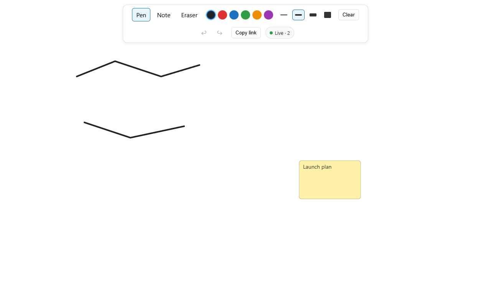
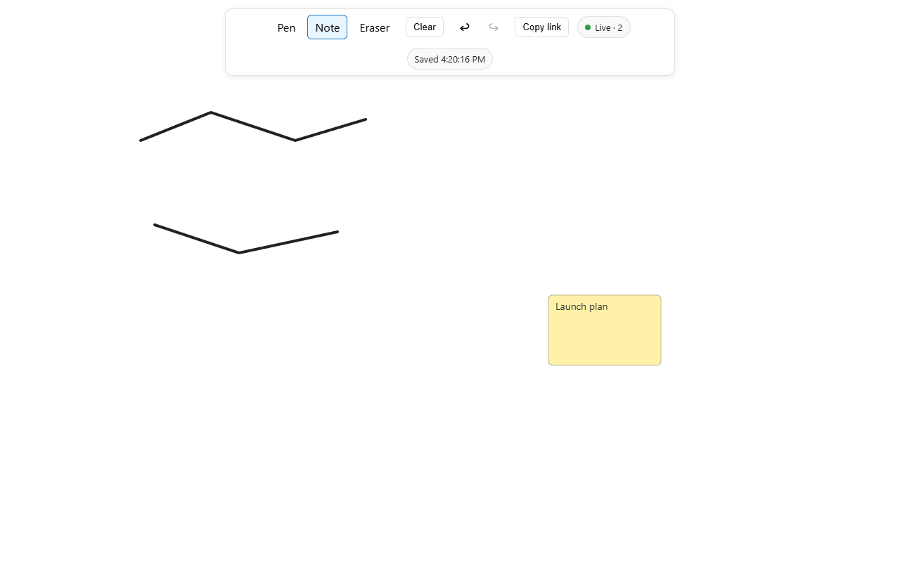
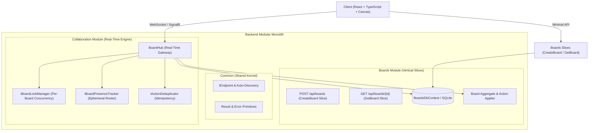

# SketchTogether

A real-time collaborative whiteboard built with a **Modular Monolith** and **Vertical Slice Architecture** on the backend (.NET 10, ASP.NET Core Minimal APIs, SignalR) and React + TypeScript + Canvas on the frontend. Create a board, share the link, and draw together — strokes and sticky notes sync live between everyone in the room.


## Demo

Two people in the same room — their names sit in the room bar and their cursor moves live on the board:



Notes in two colors, the participant list, and the save indicator at a glance:



---

## Architecture Overview

The backend follows a **Modular Monolith** combined with **Vertical Slice Architecture (VSA)**, ensuring high cohesion, clear domain boundaries, and zero leaky abstractions.



### Key Architectural Highlights:
1. **Vertical Slice Architecture (VSA)**: Feature operations (`CreateBoard`, `GetBoard`) encapsulate their endpoint definition (`IEndpoint`), command/query handler, validation, and response DTO within a single slice folder.
2. **Minimal APIs**: Built entirely on ASP.NET Core Minimal APIs without bulky controllers. Endpoints are self-registering via the `IEndpoint` discovery contract.
3. **Decoupled Real-Time Concurrency**: `BoardHub` acts strictly as an event transport gateway. State management (per-board locking, presence rosters, and message deduplication) is decoupled into injected abstractions (`IBoardLockManager`, `IBoardPresenceTracker`, `IActionDeduplicator`), making the system clean and scale-out ready.
4. **Architectural Guardrails**: Backed by automated architecture tests (`ArchitectureTests.cs`) verifying endpoint contracts, handler encapsulation, and module boundary invariants.
5. **Frontend Hook Decomposition**: Frontend logic in `client/` is decomposed into dedicated hooks (`useBoardSync`, `useShortcuts`, `useTransientPresence`) and isolated components (`PeerChips`, `StatusPill`, `SaveState`), maintaining high maintainability and zero linter warnings.

---

## Features

- **Live drawing** — freehand strokes with a color palette and four widths, synced as you draw.
- **Sticky notes** — click to place, drag to move, double-click to edit, in six colors.
- **Compact tool rail** — pen, note, and eraser behind `P` / `N` / `E`, and `Ctrl+Z` / `Ctrl+Y` for undo and redo, shared with the room.
- **View and edit links** — a new board opens its edit link; the view link is what you share. Anyone with the view link can watch live, while the key in the edit link is needed to change anything. No accounts required.
- **Presence with names and cursors** — everyone in the room appears in the room bar with a display name and a color, and their pointer moves live on the board.
- **Save state** — connection status, a save indicator on every edit, and queued edits waiting to sync while offline.
- **Persistent boards** — refresh or come back later; the board reloads exactly as left.

---

## Quickstart

### Option 1: Docker Compose (1-Command Startup)

```bash
docker compose up --build
```
Open [http://localhost:5248](http://localhost:5248) in your browser.

### Option 2: Local Development

Requirements: [.NET 10 SDK](https://dotnet.microsoft.com/download) and [Node.js 20+](https://nodejs.org/).

```powershell
# Terminal 1 — Server (http://localhost:5248)
dotnet run --project src/Server

# Terminal 2 — Client (http://localhost:5173)
cd client
npm install
npm run dev
```

---

## Testing

```powershell
# Run backend unit, integration, and architecture tests (79 tests)
dotnet test

# Run frontend tests (112 tests)
cd client
npm test

# Run frontend linter
npm run lint
```

---

## License

MIT — see [LICENSE](LICENSE).
