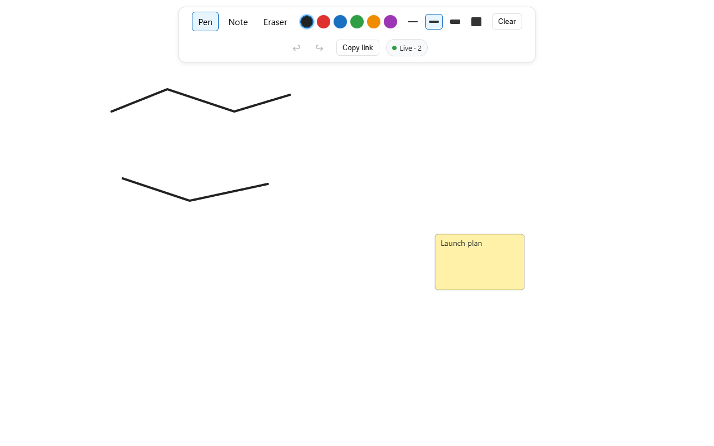
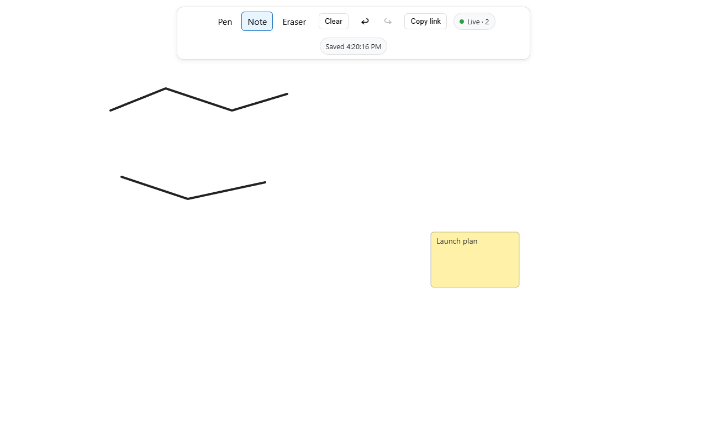

# SketchTogether

A real-time collaborative whiteboard. Create a board, share the link, and draw
together — strokes and sticky notes sync live between everyone in the room, and
everything is saved so the board is still there when you come back.


## Demo

Two people in the same room — their names sit in the room bar and their cursor
moves live on the board:



Notes in two colors, the participant list, and the save indicator at a glance:



## Features

- **Live drawing** — freehand strokes with a color palette and four widths,
  synced as you draw.
- **Sticky notes** — click to place, drag to move, double-click to edit, in six
  colors.
- **Compact tool rail** — pen, note, and eraser behind `P` / `N` / `E`, and
  `Ctrl+Z` / `Ctrl+Y` for undo and redo, shared with the room.
- **View and edit links** — a new board opens its edit link; the view link is
  what you share. Anyone with the view link can watch live, while the key in the
  edit link is needed to change anything. No accounts.
- **Presence with names and cursors** — everyone in the room appears in the room
  bar with a display name and a colour, and their pointer moves live on the
  board. Your own chip is editable, so the new name reaches the room without a
  reload.
- **Save state** — connection status, a save indicator on every edit, and how
  many edits are waiting to sync while offline.
- **Persistent boards** — refresh or come back later; the board reloads as left.

## Quickstart

Requirements: [.NET 10 SDK](https://dotnet.microsoft.com/download) and
[Node.js 20+](https://nodejs.org/).

```powershell
# Terminal 1 — server (http://localhost:5248)
dotnet run --project src/Server

# Terminal 2 — client (http://localhost:5173)
cd client
npm install
npm run dev
```

Click **New board**. You land on the edit link; copy the **view link** to share
and keep the edit link to change the board.

## Realtime model

Durable actions (strokes, notes, moves, deletes) go through the server: it
validates, applies, persists, then broadcasts to everyone else. Presence,
cursors, and drag previews are ephemeral and never stored; remote positions are
smoothed client-side so they move at frame rate instead of stepping with each
network update. See [docs/realtime.md](docs/realtime.md).

## Limits worth knowing

- Note drags stream a preview while you drag; the committed move is what gets
  saved.
- Cursors, names, and drag previews are ephemeral — a restart drops them and
  everyone rejoins.
- Offline edits queue in this tab and flush in order when the connection
  returns. The queue survives a refresh but not closing the tab, and opening a
  board still needs the server.
- Anyone with the view link can open a board. Editing needs the edit link: its
  key is the credential, stored only as a hash, so it cannot be recovered —
  losing it means losing edit access. There are no accounts, expiry, or
  revocation; changing the key would mean issuing a new board.

## License

MIT — see [LICENSE](LICENSE).
